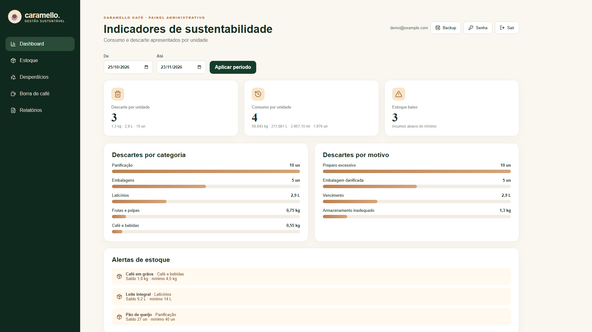

# Caramello Gestão Sustentável

A Windows-first application for café inventory and waste tracking. Developed as a computer science university extension project, it supports operational decisions aligned with UN Sustainable Development Goal 12, Responsible Consumption and Production. The interface is in Brazilian Portuguese.

**Resumo em português.** Aplicativo desktop para gestão de insumos, movimentações de estoque, descarte e destinação de borra de café. Os indicadores ajudam a acompanhar a operação por unidade de medida. O projeto não apresenta estimativas de impacto real da cafeteria.

## Features

- Manage inventory, minimum stock levels and movement history. A transactional write records each balance change and rejects withdrawals that would make stock negative.
- Compare consumption and waste by period and unit. Environmental discard records and coffee grounds are tracked separately to avoid double counting.
- Review replenishment suggestions based on average daily consumption, lead time and safety stock. The interface flags insufficient history.
- Export movements and indicators as CSV. Administrators can review audit records and create SQLite backups.

## Architecture and security

React and TypeScript render the UI. On Windows, a WinForms shell starts a local ASP.NET Core 10 API and displays the bundled frontend in WebView2. The API listens on an ephemeral loopback port and uses EF Core 10 and SQLite. The Windows installer is built with Inno Setup.

ASP.NET Core Identity provides administrator authorization and HttpOnly session cookies. Write operations use antiforgery validation. The desktop startup process checks database readiness before opening the UI. SQLite data, backups, keys and startup logs live outside the installation directory.

See [Architecture](docs/ARCHITECTURE.md) for the runtime flow, persistence model and security boundaries. Publishing this source is separate from hosting a live instance. Hosting requires the operational controls in the [deployment guide](DEPLOYMENT.md).

## Run locally

Use the .NET 10 SDK, Node.js and npm. See the [local development guide](docs/DEVELOPMENT.md) for PowerShell commands that create an isolated SQLite database, apply migrations, configure a demo administrator and run the API and Vite.

From the repository root, run the xUnit suite and build the frontend:

```powershell
dotnet test .\backend\Caramello.Api.Tests
Push-Location .\frontend
npm ci
npm run build
Pop-Location
```

The suite covers stock transactions, indicators, authorization and CSRF, audit records, SQLite backups and readiness retries.

## Build the Windows installer

Install Inno Setup 6 alongside the development prerequisites and run this command from the repository root:

```powershell
powershell.exe -NoProfile -ExecutionPolicy Bypass -File .\deploy\publish-windows.ps1
```

The script publishes self-contained x64 desktop and API binaries and builds `artifacts\installer\CaramelloSetup.exe`. See the [Windows guide](DESKTOP.md) for WebView2 requirements, startup logs and update validation.

## Application Preview

All operational records and values shown below are fictional and used exclusively for demonstration. They do not represent actual café operations or measured impact.



*Sustainability dashboard. Review consumption and waste by unit, see why items were discarded, and identify low stock.*

| Feature | Preview |
| --- | --- |
| Administrator sign-in | [Login](docs/screenshots/01-login.png) |
| Stock levels, minimums and lead times | [Inventory](docs/screenshots/03-inventory.png) |
| Consumption-based purchase quantities | [Restocking suggestions](docs/screenshots/04-restocking.png) |
| Discard totals and ratios by item | [Waste analysis](docs/screenshots/05-waste-analysis.png) |
| Grounds generated and sent for treatment | [Coffee grounds](docs/screenshots/06-coffee-grounds.png) |
| Practical composting instructions | [Composting guide](docs/screenshots/07-composting-guide.png) |
| Municipal guidance and consultation locations | [Composting locations](docs/screenshots/08-composting-locations.png) |
| Equal-period comparisons and CSV exports | [Reports](docs/screenshots/09-reports.png) |

See the [screenshot gallery](docs/SCREENSHOTS.md) for full-size views and instructions to recreate the demo locally.
