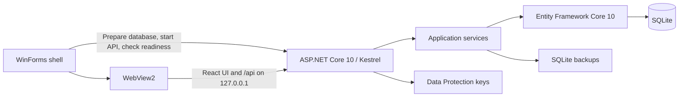

# Architecture

The primary delivery target is Windows 10/11 x64. The web development workflow runs the same React UI against the ASP.NET Core API through the Vite proxy.

## Desktop lifecycle

1. WinForms enforces a single instance. It starts a migration subprocess and makes a SQLite backup before applying pending migrations to an existing database.
2. The main API subprocess binds an ephemeral loopback port. WinForms probes `/api/health` until it receives the expected response, the API exits or the readiness deadline expires. The endpoint checks database connectivity and pending migrations.
3. WebView2 loads the UI from the API origin and limits navigation to that origin. On exit, the shell requests shutdown with a random per-process token.

The default desktop data root is `%LOCALAPPDATA%\CaramelloGestao`. It holds SQLite data, backups, keys, the WebView2 profile and filtered startup logs.

## Application boundaries

| Directory | Responsibility |
| --- | --- |
| `frontend/src` | React pages, forms, charts and JSON API client |
| `backend/Caramello.Api/Endpoints` | Minimal API routes, HTTP validation and authorization |
| `backend/Caramello.Api/Services` | Domain operations, stock transactions, reporting and backups |
| `backend/Caramello.Api/Infrastructure` and `Migrations` | EF Core mapping and SQLite schema history |
| `backend/Caramello.Api.Tests` | xUnit tests and integration fixtures |
| `desktop/Caramello.Desktop` and `deploy` | Windows host, packaging and optional server deployment scripts |

Stock quantities are stored as integer thousandths. Each balance change and its movement are committed in one transaction. Reports group quantities by unit and derive consumption and waste from stock movements. Standalone environmental and coffee-grounds records are separate sources. Replenishment suggestions use average daily consumption multiplied by lead time, plus safety stock and minus current balance, with a floor of zero and a minimum-history check.

## Security and operations

API authorization defaults to the `Administrador` role. ASP.NET Core Identity issues HttpOnly, SameSite Strict session cookies. Production cookies require HTTPS. Protected writes use antiforgery validation. Local Desktop and Development can expose the first-account setup while the database has no users, subject to the loopback check. The environment-based bootstrap can provision the initial administrator after migrations.

The app uses SQLite’s online backup API for administrator-triggered and scheduled backups. Backups and Data Protection keys are restricted runtime files. The [Windows guide](../DESKTOP.md) covers restore and upgrade procedures. The [server deployment guide](../DEPLOYMENT.md) covers the alternative Linux ARM64 environment, HTTPS and persistent storage.
